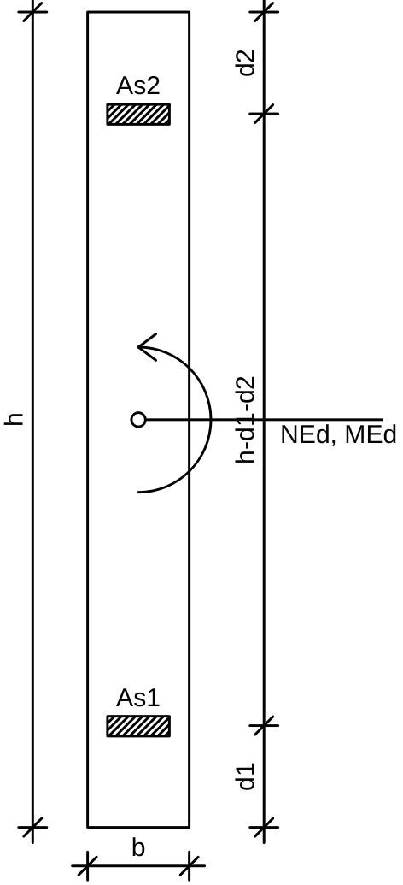
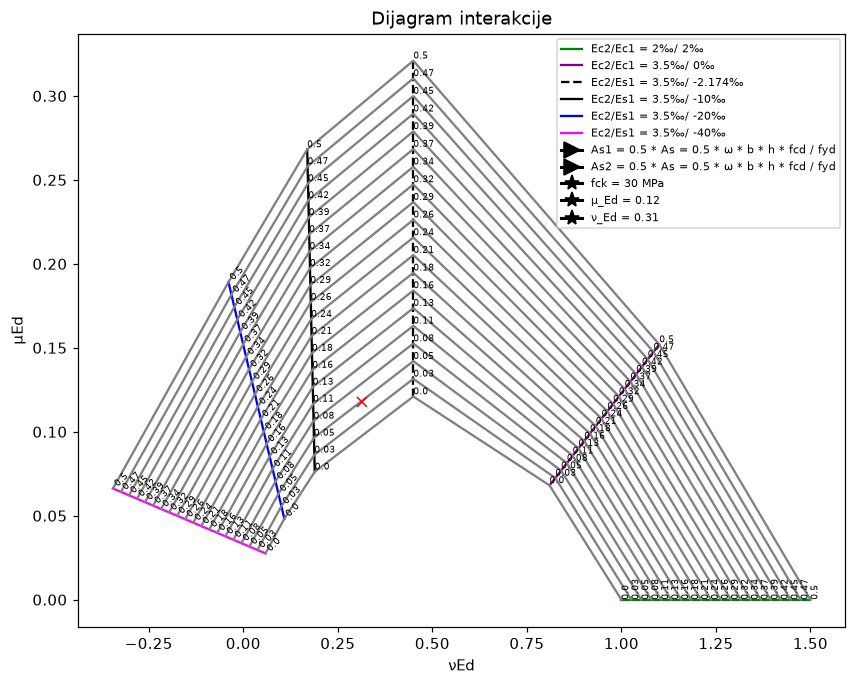

# Dijagram interakcije

[← Sadržaj](README.md) · Kod: [`interaction_diagram.py`](../GUI/ConcreteElementsWindows/interaction_diagram.py) · Izveštaj: [`InteractionDiagram_tex.py`](../LatexScripts/InteractionDiagram_tex.py), [`InteractionDiagram.tex`](../LatexTemplates/InteractionDiagram.tex)

## 1. Namena

Konstrukcija bezdimenzionalnog dijagrama interakcije $\nu_{Rd}$–$\mu_{Rd}$ za pravougaoni presek sa armaturom
$A_{s1}$ (zategnuta strana) i $A_{s2}$ (pritisnuta strana) u graničnom stanju nosivosti, za mehanički koeficijent
armiranja $\omega$ od 0 do 0.5. Na dijagram se ucrtava tačka proračunskih uticaja $(\nu_{Ed}, \mu_{Ed})$, pa se
potrebno $\omega$, a zatim i armatura, očitava sa dijagrama.

<p align="center"></p>

## 2. Ulazni podaci

| Oznaka | Polje u GUI | Jedinica | Napomena |
|---|---|---|---|
| $M_{Ed}$ | MEd | kNm | moment savijanja |
| $N_{Ed}$ | NEd | kN | pritisak +, zatezanje − |
| $f_{ck}$ | fck | MPa | |
| $k$ | k | % | udeo armature $A_{s1}$ u ukupnoj armaturi |
| $b$, $h$ | b, h | cm | dimenzije preseka |
| $d_1$, $d_2$ | d1, d2 | cm | rastojanje težišta $A_{s1}$ / $A_{s2}$ od bliže ivice |

## 3. Teorijska osnova i formule

### 3.1 Materijal i geometrija

```math
f_{cd} = 0.85 \cdot \frac{f_{ck}}{1.5}, \qquad
f_{yd} = \frac{500}{1.15}, \qquad
E_s = 200 \ \mathrm{GPa}, \qquad
\varepsilon_{yd} = \frac{f_{yd}}{E_s}, \qquad
\varepsilon_{cu2} = 3.5 ‰
```

(EN 1992-1-1, 3.1.6(1)P, 2.4.2.4 Tabela 2.1N, 3.2.7(4), Tabela 3.1.)

```math
d = h - d_1, \qquad \alpha_1 = \frac{d_1}{h}, \qquad \alpha_2 = \frac{d_2}{h}
```

### 3.2 Normalizovani uticaji

```math
\mu_{Ed} = \frac{M_{Ed}}{b \, h^2 \, f_{cd}}, \qquad
\nu_{Ed} = \frac{N_{Ed}}{b \, h \, f_{cd}}, \qquad
\mu_{Rd} = \frac{M_{Rd}}{b \, h^2 \, f_{cd}}, \qquad
\nu_{Rd} = \frac{N_{Rd}}{b \, h \, f_{cd}}
```

### 3.3 Armatura

Ukupna armatura se izražava preko mehaničkog koeficijenta armiranja $\omega$ i deli u odnosu $k$:

```math
\omega = \frac{A_s \, f_{yd}}{b \, h \, f_{cd}}, \qquad
A_{s1} = k \cdot \omega \, \frac{b \, h \, f_{cd}}{f_{yd}}, \qquad
A_{s2} = (1 - k) \cdot \omega \, \frac{b \, h \, f_{cd}}{f_{yd}}
```

### 3.4 Granična stanja dilatacija

Presek se proračunava uz pretpostavke iz **EN 1992-1-1, 6.1(2)P**: ravni preseci ostaju ravni, armatura ima istu
dilataciju kao okolni beton, čvrstoća betona na zatezanje se zanemaruje, beton prati dijagram parabola–pravougaonik
(3.1.7), a armatura bilinearni dijagram sa horizontalnom gornjom granom (**3.2.7(2)b**, Slika 3.8), za koji granica
dilatacije čelika nije merodavna. Dilatacija betona je ograničena na $\varepsilon_{cu2}$ (**6.1(3)P**). Dijagram se
dobija iz karakterističnih raspodela dilatacija sa **Slike 6.1 (6.1(6))**.

Napon u armaturi i sile u armaturi:

```math
\sigma_s = E_s \cdot \min(\varepsilon_s;\ \varepsilon_{yd}), \qquad F_{s1} = A_{s1} \, \sigma_{s1}, \qquad F_{s2} = A_{s2} \, \sigma_{s2}
```

Rezultanta pritiska u betonu, za $\varepsilon_c = 3.5$‰ na pritisnutoj ivici
(koeficijenti $\alpha_v = 0.81$ i $k_a = 0.416$, vidi [zajedničke osnove](README.md#koeficijenti-pritisnute-zone-betona)):

```math
F_c = 0.81 \cdot x \cdot b \cdot f_{cd}, \qquad \text{krak u odnosu na težište preseka: } \frac{h}{2} - 0.416 \, x
```

**Stanje 1 — centrični pritisak** ($\varepsilon_{c2} = \varepsilon_{c1} = 2$‰, **6.1(5)**). Armatura je simetrična
($\omega_1 = \omega_2 = 0.5\,\omega$):

```math
N_{Rd} = (1 + \omega) \, b \, h \, f_{cd}, \qquad
M_{Rd} = \left[\omega_2 (0.5 - \alpha_2) - \omega_1 (0.5 - \alpha_1)\right] b \, h^2 \, f_{cd}
```

**Stanje 2 — granica malog ekscentriciteta** ($\varepsilon_{c2} = 3.5$‰, $\varepsilon_{c1} = 0$, neutralna linija na donjoj ivici, $x = h$):

```math
\varepsilon_{s2} = \varepsilon_{cu2} (1 - \alpha_2), \qquad
\varepsilon_{s1} = \varepsilon_{cu2} \, \alpha_1, \qquad
F_c = 0.81 \, \frac{d}{1 - \alpha_1} \, b \, f_{cd} = 0.81 \, h \, b \, f_{cd}
```

```math
N_{Rd} = F_c + F_{s1} + F_{s2}, \qquad
M_{Rd} = F_c \left(\frac{h}{2} - 0.416 \, x\right) + F_{s2} \left(\frac{h}{2} - d_2\right) - F_{s1} \left(\frac{h}{2} - d_1\right)
```

**Stanja 3–6 — savijanje sa zategnutom armaturom** ($\varepsilon_{c2} = 3.5$‰, $\varepsilon_{s1}$ = 2.174‰, 10‰, 20‰ i 40‰):

```math
x = \frac{\varepsilon_{cu2} \, (h - d_1)}{\varepsilon_{s1} + \varepsilon_{cu2}}, \qquad
\varepsilon_{s2} = \varepsilon_{cu2} \, \frac{x - d_2}{x}
```

```math
N_{Rd} = F_c - F_{s1} + F_{s2}, \qquad
M_{Rd} = F_c \left(\frac{h}{2} - 0.416 \, x\right) + F_{s2} \left(\frac{h}{2} - d_2\right) + F_{s1} \left(\frac{h}{2} - d_1\right)
```

Stanje 3 ($\varepsilon_{s1} = \varepsilon_{yd}$) je granica tečenja zategnute armature (balansirani lom).

## 4. Tok proračuna u programu

Klasa `DijagramInterakcije`:

| Korak | Metoda | Šta radi |
|---|---|---|
| 1 | `__init__` | Jedinice (cm → m), $f_{cd}$, $f_{yd}$, $\varepsilon_{yd}$, $\alpha_1$, $\alpha_2$, $\mu_{Ed}$ (`mi_Ed`), $\nu_{Ed}$ (`ni_Ed`). |
| 2 | `gustina_omege()` | 20 vrednosti $\omega$ ravnomerno od 0 do 0.5. |
| 3 | `beta2_koeficijent(eps)` | $k_a$ za zadatu dilataciju (formule iz [zajedničkih osnova](README.md#koeficijenti-pritisnute-zone-betona)). |
| 4 | `centricni_pritisak()` | Stanje 1: niz $(\nu_{Rd}, \mu_{Rd})$ za sve $\omega$. |
| 5 | `granica_malog_ekscentriciteta()` | Stanje 2. |
| 6 | `tri_i_po_sa_dva_jedan_sedam_cetiri()`, `tri_i_po_sa_deset()`, `tri_i_po_sa_dvadeset()`, `tri_i_po_sa_cetrdeset()` | Stanja 3–6. |
| 7 | `stampa_na_osi(ax)` | Crta krive svih stanja, linije konstantnog $\omega$ (sive) sa oznakama, i tačku $(\nu_{Ed}, \mu_{Ed})$. |
| 8 | `self.stanja` | Međurezultati ($x$, $\varepsilon_{s1}$, $\varepsilon_{s2}$, $k_a$) po stanjima, za izveštaj. |

## 5. Rezultati

Prozor sa dijagramom (matplotlib, sa alatima za uvećanje i snimanje). Potrebno $\omega$ se očitava interpolacijom između
sivih linija konstantnog $\omega$ u okolini tačke $(\nu_{Ed}, \mu_{Ed})$, a armatura iz izraza u 3.3.

<p align="center"></p>

*Primer: $b/h = 30/50$ cm, $d_1 = d_2 = 5$ cm, $f_{ck} = 30$ MPa, $k = 50$%, $M_{Ed} = 150$ kNm, $N_{Ed} = 800$ kN.*

Program ne sprovodi automatsku kontrolu; ne računa $\omega$ za zadatu tačku.

## 6. Pretpostavke i odstupanja od Evrokoda

- Koristi se $\alpha_{cc} = 0.85$ (preporuka EN 1992-1-1 je 1.0, vrednost propisuje nacionalni aneks).
- Armatura je B500 ($f_{yk} = 500$ MPa), sa horizontalnom gornjom granom dijagrama (3.2.7(2)b).
- Kod centričnog pritiska (stanje 1) armatura se računa sa $f_{yd}$, iako je pri $\varepsilon = 2$‰ napon u armaturi
  $E_s \cdot 0.002 = 400$ MPa $< f_{yd}$. Takođe se uzima $\omega_1 = \omega_2 = 0.5\,\omega$, bez obzira na zadato $k$.
- U stanjima 3–6, kada je $x < d_2$, armatura $A_{s2}$ je zategnuta; tada se dilatacija $\varepsilon_{s2}$ ne ograničava na
  $-\varepsilon_{yd}$.
- Između karakterističnih stanja (npr. od stanja 2 do čistog pritiska) dijagram se ne proračunava; sive linije konstantnog
  $\omega$ samo spajaju tačke susednih stanja pravim linijama.
