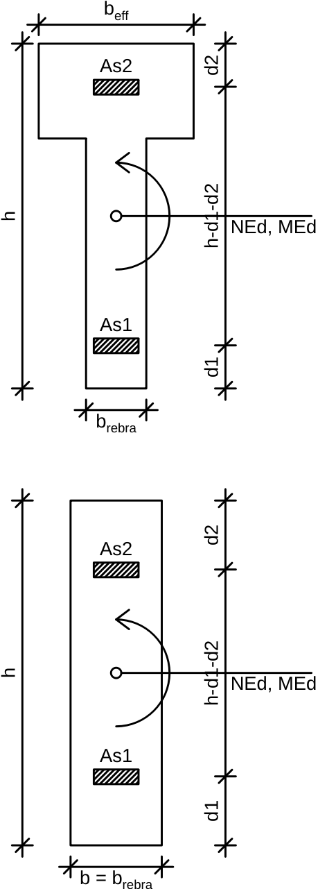

# Složeno savijanje

[← Sadržaj](README.md) · Kod: [`composite_bending.py`](../GUI/ConcreteElementsWindows/composite_bending.py) · Skripta: [`SlozenoSavijanje.py`](../Scripts/SlozenoSavijanje.py) · Izveštaj: [`CompositeBending_tex.py`](../LatexScripts/CompositeBending_tex.py), [`CompositeBending.tex`](../LatexTemplates/CompositeBending.tex)

## 1. Namena

Dimenzionisanje podužne armature pravougaonog preseka (ili T-preseka sa pritisnutom flanšom) opterećenog
momentom savijanja $M_{Ed}$ i aksijalnom silom $N_{Ed}$ u graničnom stanju nosivosti. Program sam bira proračunski
slučaj prema položaju rezultante:

- centrični pritisak,
- centrično ili ekscentrično zatezanje,
- veliki ekscentricitet: jednostruko ili dvojno armiran presek,
- mali ekscentricitet: ceo presek pritisnut, simetrična armatura.

<p align="center"></p>

## 2. Ulazni podaci

| Oznaka | Polje u GUI | Jedinica | Napomena |
|---|---|---|---|
| — | Ime grede | — | oznaka grede u naslovu izveštaja i u imenu fajla |
| $M_{Ed}$ | MEd | kNm | uzima se apsolutna vrednost |
| $N_{Ed}$ | NEd | kN | pritisak +, zatezanje − |
| $b_{eff}$ | beff | cm | efektivna širina pritisnute flanše kod T-preseka; kod pravougaonog preseka širina preseka. U formulama $b = b_{eff}$ |
| $b_w$ | b rebra | cm | širina rebra, za minimalnu armaturu; kod pravougaonog preseka $b_w = b$ |
| $h$ | h | cm | visina preseka |
| $f_{ck}$ | fck | MPa | standardna klasa iz [`MaterialData/BetonPodaci.csv`](../MaterialData/BetonPodaci.csv) (odatle i $f_{ctm}$) |
| $d_1$ | d1 | cm | rastojanje težišta zategnute armature od zategnute ivice |
| $d_2$ | d2 | cm | rastojanje težišta pritisnute armature od pritisnute ivice |

## 3. Teorijska osnova i formule

### 3.1 Materijal i pretpostavke

```math
f_{cd} = 0.85 \cdot \frac{f_{ck}}{1.5}, \qquad
f_{yd} = \frac{500}{1.15} = 434.78 \ \mathrm{MPa}, \qquad
E_s = 200 \ \mathrm{GPa}, \qquad
\varepsilon_{yd} = \frac{f_{yd}}{E_s} = 2.174 ‰, \qquad
d = h - d_1
```

(EN 1992-1-1, 3.1.6(1)P, 2.4.2.4 Tabela 2.1N, 3.2.7(4).) Presek se proračunava uz pretpostavke iz
**EN 1992-1-1, 6.1(2)P**, sa dijagramom parabola–pravougaonik (**3.1.7**) i graničnim dilatacijama
$\varepsilon_{c2} = 2$‰ i $\varepsilon_{cu2} = 3.5$‰ (**Tabela 3.1**); raspodele dilatacija odgovaraju
**Slici 6.1 (6.1(6))**.

### 3.2 Izbor proračunskog slučaja

Naponi na ivicama preseka (linearna raspodela, širina $b$) i moment u odnosu na težište zategnute armature:

```math
\sigma_{1,2} = \frac{N_{Ed}}{b \, h} \mp \frac{6 \, M_{Ed}}{b \, h^2}, \qquad
M_{Edu} = M_{Ed} + N_{Ed} \left(\frac{h}{2} - d_1\right)
```

| Uslov | Slučaj |
|---|---|
| $M_{Ed} = 0$ i $\sigma_1 > 0$ | centrični pritisak (3.3) |
| $\sigma_2 < 0$, ili $N_{Ed} < 0$ i $M_{Edu} \leq 0$ | zatezanje (3.4) |
| $\sigma_1 \geq 0$ | mali ekscentricitet (3.7) |
| inače | veliki ekscentricitet (3.5), po potrebi dvojno armiranje (3.6) ili mali ekscentricitet (3.7) |

### 3.3 Centrični pritisak

```math
\sigma_c = \frac{N_{Ed}}{A_c} \leq f_{cd}, \qquad
A_s = \max\left(0.15 \, \frac{N_{Ed}}{f_{yd}};\ 0.003 \, A_c;\ 4\phi 12 = 4.52 \ \mathrm{cm^2}\right)
```

Za poređenje, EN 1992-1-1, **9.5.2(2), izraz (9.12N)** preporučuje
$A_{s,min} = \max(0.10 \, N_{Ed}/f_{yd};\ 0.002 \, A_c)$, a **9.5.2(1) i (4)** najmanji prečnik 8 mm i bar po jednu
šipku u svakom uglu. Program je strožiji od ovih preporuka (vidi 6).

### 3.4 Zatezanje

Ceo presek je zategnut kada sila deluje između armatura ($\sigma_2 < 0$, ili $M_{Edu} \leq 0$ kod sile zatezanja).
Beton ne prima zatezanje (**6.1(2)P**), pa silu $N = |N_{Ed}|$ primaju obe armature po pravilu poluge:

```math
e = \frac{M_{Ed}}{N}, \qquad c_1 = \frac{h}{2} - d_1, \qquad c_2 = \frac{h}{2} - d_2, \qquad
A_{s1} = \frac{N}{f_{yd}} \cdot \frac{c_2 + e}{c_1 + c_2}, \qquad
A_{s2} = \frac{N}{f_{yd}} \cdot \frac{c_2 - e}{c_1 + c_2}
```

Za $e = 0$ (centrično zatezanje) ukupna armatura je $A_s = N / f_{yd}$.

### 3.5 Veliki ekscentricitet — jednostruko armiran presek

Pritisnuta ivica dostiže $\varepsilon_{cu2} = 3.5$‰, a koeficijenti pritisnute zone su $\alpha_v = 0.81$ i
$k_a = 0.416$ ([zajedničke osnove](README.md#koeficijenti-pritisnute-zone-betona)). Ravnoteža momenata oko
zategnute armature daje kvadratnu jednačinu po $\xi = x/d$:

```math
M_{Edu} = 0.81 \, \xi \, (1 - 0.416 \, \xi) \, b \, d^2 f_{cd}
\quad \Rightarrow \quad
a \, \xi^2 + b' \, \xi + c = 0, \qquad
a = -0.33696 \, K, \quad b' = 0.81 \, K, \quad c = -M_{Edu}, \quad K = b \, d^2 f_{cd}
```

```math
D = b'^2 - 4 a c, \qquad
\xi = \frac{-b' + \sqrt{D}}{2 a}, \qquad
\varepsilon_{s1} = \frac{1 - \xi}{\xi} \cdot 3.5 ‰, \qquad
A_{s1} = 0.81 \, \xi \, \frac{f_{cd}}{f_{yd}} \, b \, d - \frac{N_{Ed}}{f_{yd}}
```

Kako je $a < 0$, izraz sa $+\sqrt{D}$ daje manji (merodavan) koren. Ishodi:

- $D < 0$: jednostruko armiran presek ne može da primi $M_{Edu}$ (to važi za $M_{Edu} > 0.4868 \, K$) → dvojno armiranje (3.6).
- $A_{s1} < 0$: zategnuta armatura nije potrebna → mali ekscentricitet (3.7).
- $|\varepsilon_{s1}| \leq 2.5$‰: armatura ne teče dovoljno → dvojno armiranje (3.6).
- Inače se usvaja $A_{s1}$, uz kontrolu najmanje i najveće armature.

Minimalna armatura po **EN 1992-1-1, 9.2.1.1(1), izraz (9.1N)**, sa širinom rebra $b_w$:

```math
A_{s,min} = \max\left(0.26 \, \frac{f_{ctm}}{f_{yk}} \, b_w \, d;\ 0.0013 \, b_w \, d\right)
```

Najveća armatura u programu odgovara granici $\xi \approx 0.584$ (zategnuta armatura teče):

```math
A_{s,max} = 0.473 \, b \, d \, \frac{f_{cd}}{f_{yd}}
```

### 3.6 Dvojno armiranje

Neutralna linija se fiksira na $\xi_{lim} = 0.583$, što odgovara $\varepsilon_{s1} = 2.5$‰ pri $\varepsilon_{cu2} = 3.5$‰.
Pritisnuta armatura prima razliku momenta:

```math
M_{lim} = 0.81 \, \xi_{lim} (1 - 0.416 \, \xi_{lim}) \, b \, d^2 f_{cd} = \left(\frac{d}{1.672}\right)^2 b \, f_{cd} = 0.3577 \, b \, d^2 f_{cd}
```

```math
\Delta M = M_{Edu} - M_{lim}, \qquad
A_{s2} = \frac{\Delta M}{(d - d_2) \, f_{yd}}, \qquad
A_{s1} = 0.81 \, \xi_{lim} \, \frac{f_{cd}}{f_{yd}} \, b \, d - \frac{N_{Ed}}{f_{yd}} + A_{s2}
```

Ako je $A_{s2} > A_{s1}$, ceo presek je pritisnut → mali ekscentricitet (3.7).

### 3.7 Mali ekscentricitet — simetrično armiran presek

Ceo presek je pritisnut. Raspodela dilatacija se obrće oko tačke C sa **Slike 6.1**, na rastojanju
$(1 - \varepsilon_{c2}/\varepsilon_{cu2}) \, h = \tfrac{3}{7} h$ od pritisnutije ivice, gde je dilatacija 2‰. Za dilataciju na
pritisnutijoj ivici $\varepsilon_{c2}$ od 2‰ do 3.5‰, uz $\alpha_i = d_i / h$:

```math
\varepsilon_{s1} = \frac{2 (1 - \alpha_1) - \varepsilon_{c2} \left(\tfrac{4}{7} - \alpha_1\right)}{3/7} \leq \varepsilon_{yd}, \qquad
\varepsilon_{s2} = \frac{2 \, \alpha_2 + \varepsilon_{c2} \left(\tfrac{3}{7} - \alpha_2\right)}{3/7} \leq \varepsilon_{yd}, \qquad
\sigma_{si} = E_s \, \varepsilon_{si}
```

Rezultanta pritiska u betonu (koeficijenti dijagrama parabola–pravougaonik za ceo pritisnut presek; za
$\varepsilon_{c2} = 2$‰ je $\beta_3 = 1$, a za $\varepsilon_{c2} = 3.5$‰ je $\beta_3 = 0.8095$ i $\beta_4 = 0.416$):

```math
F_c = \beta_3 \, b \, h \, f_{cd}, \qquad
\beta_3 = \frac{125 + 64 \, \varepsilon_{c2} - 16 \, \varepsilon_{c2}^2}{189}, \qquad
\beta_4 = \frac{3}{14} \cdot \frac{(8 \, \varepsilon_{c2} + 5)(37 - 8 \, \varepsilon_{c2})}{125 + 64 \, \varepsilon_{c2} - 16 \, \varepsilon_{c2}^2}
```

Ravnoteža momenata oko $A_{s1}$ i ravnoteža sila:

```math
F_c \, (d - \beta_4 h) + A_{s2} \, \sigma_{s2} \, (d - d_1) = M_{Edu}, \qquad
F_c + A_{s1} \, \sigma_{s1} + A_{s2} \, \sigma_{s2} = N_{Ed}
```

Usvaja se prvo $\varepsilon_{c2}$ (od 2‰ naviše) za koje je $0 \leq A_{s1}, A_{s2} \leq 0.04 \, b \, h$, i simetrična armatura
$A_{s1} = A_{s2} = \max(A_{s1}, A_{s2})$. Ako takvo stanje ne postoji, u preseku postoji i zategnuta armatura
(ili je potrebno više od 4% armature), pa presek treba dimenzionisati pomoću [dijagrama interakcije](dijagram_interakcije.md).

## 4. Tok proračuna u programu

Klasa `SlozenoSavijanje`:

| Korak | Metoda | Šta radi |
|---|---|---|
| 1 | `__init__` | Jedinice (cm → m), $f_{ck}$ i $f_{ctm}$ iz CSV fajla, $f_{cd}$, $f_{yd}$, $\varepsilon_{yd}$, $\sigma_1$, $\sigma_2$, $M_{Edu}$. |
| 2 | `proracun()` | Bira slučaj (3.2); za veliki ekscentricitet rešava kvadratnu jednačinu i kontroliše $A_{s,min}$ i $A_{s,max}$. |
| 3 | `_centricni_pritisak()`, `_zatezanje()` | Slučajevi 3.3 i 3.4. |
| 4 | `_dvojno_armiranje()` | Slučaj 3.6; za $A_{s2} > A_{s1}$ prelazi u mali ekscentricitet. |
| 5 | `_mali_ekscentricitet()` | Slučaj 3.7; za svako od 1000 vrednosti $\varepsilon_{c2}$ rešava obe jednačine ravnoteže direktno. |
| 6 | `minimalni_i_maksimalni_procenat()` | $A_{s,min}$ i $A_{s,max}$. |
| 7 | `self.koraci`, `self.rezultat` | Redosled grana sa međurezultatima (za izveštaj) i konačan rezultat sa porukama. |

## 5. Rezultati i kontrole

| Slučaj | Rezultat | Kontrole |
|---|---|---|
| Centrični pritisak | ukupna armatura $A_s$ | $\sigma_c \leq f_{cd}$ (inače: povećati presek ili marku betona) |
| Zatezanje | $A_{s1}$, $A_{s2}$ (ili ukupno $A_s$) | – |
| Jednostruko armiranje | $A_{s1}$, $\xi$, $x$, $\varepsilon_{s1}$ | $A_{s1} \geq A_{s,min}$ (inače se usvaja $A_{s,min}$); $A_{s1} \leq A_{s,max}$ |
| Dvojno armiranje | $A_{s1}$, $A_{s2}$ | – |
| Mali ekscentricitet | $A_{s1} = A_{s2}$, $\varepsilon_{c2}$ | rešenje sa $A_{s} \leq 4$% (inače: dijagram interakcije) |

## 6. Pretpostavke i odstupanja od Evrokoda

- Koristi se $\alpha_{cc} = 0.85$ (preporuka EN 1992-1-1 je 1.0; vrednost propisuje nacionalni aneks).
- Naponi $\sigma_1$, $\sigma_2$ za izbor slučaja računaju se za pravougaonik $b \times h$, i kod T-preseka.
- **Centrični pritisak:** minimalna armatura $\max(0.15 N_{Ed}/f_{yd};\ 0.003 A_c;\ 4\phi12)$ je strožija od preporuke
  izraza (9.12N). Kontrola $\sigma_c \leq f_{cd}$ ne uzima u obzir nosivost armature.
- **Najveća armatura:** kod jednostrukog armiranja $A_{s,max} = 0.473 \, b \, d \, f_{cd}/f_{yd}$ je uslov duktilnosti, a ne granica
  $0.04 A_c$ iz 9.2.1.1(3) i 9.5.2(3). Kod dvojnog armiranja gornja granica ukupne armature se ne proverava.
- **Dvojno armiranje:** pretpostavlja se da pritisnuta armatura teče ($\sigma_{s2} = f_{yd}$), što se ne proverava. Granica
  $\xi_{lim} = 0.583$ odgovara $\varepsilon_{s1} = 2.5$‰, a ne $\varepsilon_{yd} = 2.174$‰.
- **Mali ekscentricitet:** armatura je simetrična i uzima se $d_2 = d_1$ (unesena vrednost $d_2$ se ovde ne koristi). Granica
  $0.04 \, b \, h$ važi za svaku stranu posebno. $\varepsilon_{c2}$ se proverava u 1000 koraka od 2‰ do 3.5‰.
- **Razlike u odnosu na skriptu** [`SlozenoSavijanje.py`](../Scripts/SlozenoSavijanje.py):
  1. Mali ekscentricitet se u skripti traži grubom pretragom (do 1000 × 500 × 500 kombinacija, uz toleranciju 5 kN i 5 kNm),
     a u programu tačnim rešavanjem jednačina, pa se rezultati razlikuju u okviru te tolerancije (do oko 0.3 cm²).
  2. Zatezanje sa silom između armatura ($N_{Ed} < 0$, $M_{Edu} \leq 0$, a $\sigma_2 \geq 0$) skripta računa kao savijanje i
     dobija negativno $\xi$ (za $M_{Edu} = 0$ deli nulom); program ga računa po pravilu poluge (3.4).
