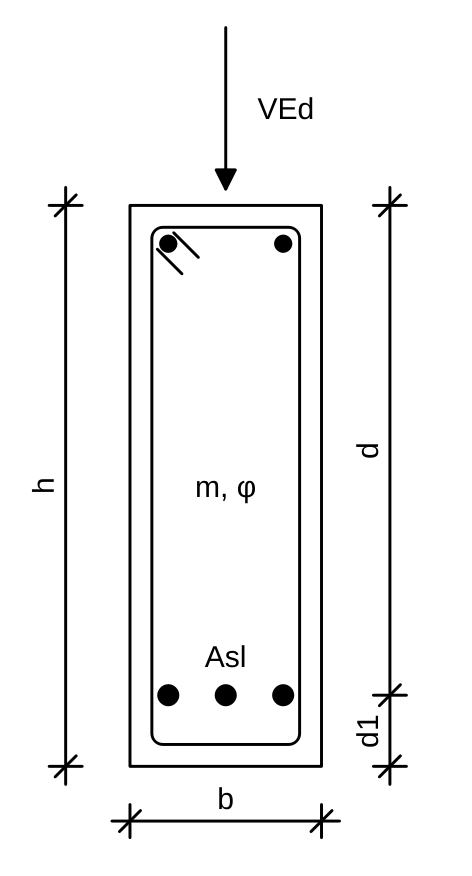

# Smicanje

[← Sadržaj](README.md) · Kod: [`shear.py`](../GUI/ConcreteElementsWindows/shear.py) · Skripta: [`Smicanje.py`](../Scripts/Smicanje.py) · Izveštaj: [`Shear_tex.py`](../LatexScripts/Shear_tex.py), [`Shear.tex`](../LatexTemplates/Shear.tex)

## 1. Namena

Dimenzionisanje poprečne armature (vertikalnih uzengija) grede pravougaonog preseka za proračunsku silu smicanja
$V_{Ed}$ u graničnom stanju nosivosti. Program:

- računa nosivost bez računske armature $V_{Rd,c}$ i nosivost pritisnutih dijagonala $V_{Rd,max}$,
- određuje da li je dovoljna minimalna armatura ili je potrebna računska,
- za uzengije $\phi 8$, $\phi 10$ i $\phi 12$ zadate sečnosti daje najveće dozvoljeno rastojanje,
- računa najveća podužna i poprečna rastojanja i dodatnu zategnutu podužnu armaturu.

<p align="center"></p>

## 2. Ulazni podaci

| Oznaka | Polje u GUI | Jedinica | Napomena |
|---|---|---|---|
| — | Ime grede | — | oznaka grede u naslovu izveštaja i u imenu fajla |
| $V_{Ed}$ | VEd | kN | uzima se apsolutna vrednost |
| $b_w$ | b | cm | najmanja širina preseka u zategnutoj zoni |
| $h$ | h | cm | visina preseka |
| $d_1$ | d1 | cm | rastojanje težišta zategnute armature od zategnute ivice |
| $f_{ck}$ | fck | MPa | standardna klasa iz [`MaterialData/BetonPodaci.csv`](../MaterialData/BetonPodaci.csv) |
| $A_{sl}$ | Asl | cm² | zategnuta podužna armatura, sidrena najmanje $l_{bd} + d$ iza posmatranog preseka (Slika 6.3) |
| $m$ | m | — | sečnost uzengija (broj krakova); podrazumevano 2 |

## 3. Teorijska osnova i formule

### 3.1 Materijal, geometrija i model rešetke

```math
f_{cd} = 0.85 \cdot \frac{f_{ck}}{1.5}, \qquad
f_{ywd} = f_{yd} = \frac{500}{1.15} = 434.78 \ \mathrm{MPa}, \qquad
d = h - d_1, \qquad
z = 0.9 \, d
```

Krak unutrašnjih sila $z = 0.9d$ je približna vrednost iz **EN 1992-1-1, 6.2.3(1)**. Nagib pritisnutih dijagonala je
$\theta = 45^\circ$ ($\cot\theta = 1$, donja granica izraza **(6.7N)** $1 \leq \cot\theta \leq 2.5$), a uzengije su vertikalne
($\alpha = 90^\circ$, $\cot\alpha = 0$).

### 3.2 Nosivost bez računske armature — EN 1992-1-1, 6.2.2(1)

Izrazi **(6.2.a)** i **(6.2.b)**, bez aksijalne sile ($\sigma_{cp} = 0$), sa preporučenim vrednostima
$C_{Rd,c} = 0.18/\gamma_c$ i $v_{min}$ iz izraza **(6.3N)**:

```math
k = 1 + \sqrt{\frac{200}{d}} \leq 2.0 \ (d \text{ u mm}), \qquad
\rho_l = \frac{A_{sl}}{b_w \, d} \leq 0.02
```

```math
V_{Rd,c} = \max\left( C_{Rd,c} \, k \, (100 \, \rho_l \, f_{ck})^{1/3} \, b_w \, d;\ \ v_{min} \, b_w \, d \right), \qquad
v_{min} = 0.035 \, k^{3/2} \, f_{ck}^{1/2}
```

### 3.3 Nosivost pritisnutih betonskih dijagonala — EN 1992-1-1, 6.2.3(3)

Izraz **(6.9)**, sa $\alpha_{cw} = 1$ (bez prethodnog naprezanja) i preporučenom vrednošću $\nu_1 = \nu$ iz izraza **(6.6N)**:

```math
\nu_1 = 0.6 \left(1 - \frac{f_{ck}}{250}\right), \qquad
V_{Rd,max} = \frac{\alpha_{cw} \, b_w \, z \, \nu_1 \, f_{cd}}{\cot\theta + \tan\theta} = \frac{b_w \, z \, \nu_1 \, f_{cd}}{2}
```

Kontrola: $V_{Ed} \leq V_{Rd,max}$. Ako nije ispunjena, presek ili marku betona treba povećati i proračun se tu završava.

### 3.4 Izbor slučaja

| Uslov | Slučaj |
|---|---|
| $V_{Ed} \leq V_{Rd,c}$ | računska armatura nije potrebna; postavlja se minimalna armatura (**6.2.1(4)**, **9.2.2(5)**) |
| $V_{Rd,c} < V_{Ed} \leq V_{Rd,max}$ | potrebna je računska armatura (**6.2.3**) |
| $V_{Ed} > V_{Rd,max}$ | prekoračena nosivost pritisnutih dijagonala |

U oba slučaja sa armaturom rastojanje se određuje isto (3.5); kod minimalne armature merodavni su $s_{w,min}$ i $s_{l,max}$.

### 3.5 Rastojanje uzengija

Iz uslova $V_{Ed} \leq V_{Rd,s}$, izraz **(6.8)**, sa $A_{sw} = m \cdot A_{sw1}$ ($A_{sw1}$ je površina jedne šipke):

```math
V_{Rd,s} = \frac{A_{sw}}{s} \, z \, f_{ywd} \cot\theta \quad \Rightarrow \quad
s_{rac} = \frac{m \, A_{sw1} \, z \, f_{ywd} \cot\theta}{V_{Ed}}
```

Minimalni procenat armiranja, izrazi **(9.4)** i **(9.5N)** (**9.2.2(5)**), daje najveće rastojanje:

```math
\rho_w = \frac{A_{sw}}{s \, b_w \sin\alpha} \geq \rho_{w,min} = \frac{0.08 \sqrt{f_{ck}}}{f_{yk}}
\quad \Rightarrow \quad
s_{w,min} = \frac{m \, A_{sw1}}{\rho_{w,min} \, b_w}
```

Najveće podužno rastojanje $s_{l,max}$ (vidi odeljak 6 — strožije od preporuke **(9.6N)** $s_{l,max} = 0.75 d$):

| Sila smicanja | $f_{ck} \leq 50$ MPa | $f_{ck} > 50$ MPa |
|---|---|---|
| $V_{Ed} \leq 0.3 \, V_{Rd,max}$ | $\min(0.75 d;\ 30 \ \mathrm{cm})$ | $\min(0.75 d;\ 20 \ \mathrm{cm})$ |
| $0.3 \, V_{Rd,max} < V_{Ed} \leq 0.6 \, V_{Rd,max}$ | $\min(0.55 d;\ 30 \ \mathrm{cm})$ | $\min(0.55 d;\ 20 \ \mathrm{cm})$ |
| $V_{Ed} > 0.6 \, V_{Rd,max}$ | $\min(0.3 d;\ 20 \ \mathrm{cm})$ | $\min(0.3 d;\ 20 \ \mathrm{cm})$ |

Usvojeno rastojanje za svaki prečnik:

```math
s = \min\left(s_{rac};\ s_{w,min};\ s_{l,max}\right)
```

Najveće poprečno rastojanje krakova $s_{t,max}$ (preporuka **9.2.2(8)**, izraz **(9.8N)**: $0.75 d \leq 600$ mm):

| Sila smicanja | $f_{ck} \leq 50$ MPa | $f_{ck} > 50$ MPa |
|---|---|---|
| $V_{Ed} \leq 0.6 \, V_{Rd,max}$ | $\min(0.75 d;\ 60 \ \mathrm{cm})$ | $\min(0.75 d;\ 40 \ \mathrm{cm})$ |
| $V_{Ed} > 0.6 \, V_{Rd,max}$ | $\min(0.3 d;\ 30 \ \mathrm{cm})$ | $\min(0.3 d;\ 30 \ \mathrm{cm})$ |

### 3.6 Dodatna zategnuta armatura — EN 1992-1-1, 6.2.3(7)

Dodatna sila zatezanja u podužnoj armaturi usled smicanja, izraz **(6.18)**, i odgovarajuća površina armature:

```math
\Delta F_{td} = 0.5 \, V_{Ed} \left(\cot\theta - \cot\alpha\right) = 0.5 \, V_{Ed}, \qquad
\Delta A_{s1} = \frac{\Delta F_{td}}{f_{yd}}
```

## 4. Tok proračuna u programu

Klasa `Smicanje`:

| Korak | Metoda | Šta radi |
|---|---|---|
| 1 | `__init__` | Jedinice (cm → m, cm² → m²), provera $f_{ck}$ i površine šipki $\phi 8$, $\phi 10$, $\phi 12$ iz CSV fajla, $f_{cd}$, $f_{yd}$, $d$, $z$. |
| 2 | `VRd_c()` | $k$, $\rho_l$, $V_{Rd,c1}$, $v_{min}$, $V_{Rd,c,min}$ i $V_{Rd,c}$ (3.2). |
| 3 | `VRd_max()` | $\nu_1$ i $V_{Rd,max}$ (3.3). |
| 4 | `s_rac()`, `s_min_armatura()` | Rastojanje iz (6.8) i iz minimalnog procenta armiranja (3.5). |
| 5 | `sl_max()`, `st_max()` | Najveća podužna i poprečna rastojanja (3.5). |
| 6 | `proracun()` | Bira slučaj (3.4), računa rastojanja za sva tri prečnika i $\Delta A_{s1}$ (3.6); vraća rezultat sa porukama za prozor i izveštaj. |

## 5. Rezultati i kontrole

| Rezultat | Kontrola |
|---|---|
| $V_{Rd,c}$, $V_{Rd,max}$ | $V_{Ed} \leq V_{Rd,max}$ (inače: povećati presek ili marku betona) |
| slučaj: minimalna ili računska armatura | $V_{Ed} \leq V_{Rd,c}$ (bira granu, nije kontrola) |
| $s$ za $\phi 8$, $\phi 10$, $\phi 12$ | $s \leq s_{rac}$, $s \leq s_{w,min}$, $s \leq s_{l,max}$ |
| $s_{t,max}$ | – |
| $\Delta F_{td}$, $\Delta A_{s1}$ | – |

Rastojanja su prikazana sa dve decimale i nisu zaokružena na praktične vrednosti; usvaja se prvo manje praktično rastojanje.

## 6. Pretpostavke i odstupanja od Evrokoda

- Koristi se $\alpha_{cc} = 0.85$ i u $f_{cd}$ za $V_{Rd,max}$ (preporuka EN 1992-1-1 je 1.0; vrednost propisuje nacionalni aneks).
- **Ugao dijagonala** je fiksan, $\theta = 45^\circ$. To je donja granica $\cot\theta = 1$ iz (6.7N), za koju je potrebno najviše uzengija;
  veći $\cot\theta$ (do 2.5) dao bi manje uzengija, ali manji $V_{Rd,max}$ i veće $\Delta F_{td}$.
- **Aksijalna sila** se ne uzima u obzir ($\sigma_{cp} = 0$ u (6.2.a) i (6.2.b)); za pritisnute elemente to je na strani sigurnosti,
  a za zategnute nije.
- **Najveće podužno rastojanje** $s_{l,max}$ zavisi od $V_{Ed}/V_{Rd,max}$ i ograničeno je na 30 ili 20 cm. To je strožije od
  preporuke (9.6N), $s_{l,max} = 0.75 d$. Slično, za $V_{Ed} > 0.6 V_{Rd,max}$ i $s_{t,max}$ je strožije od (9.8N).
  Granice su preuzete iz skripte.
- $f_{ywd} = f_{yd}$ (bez smanjenja na $0.8 f_{ywk}$, jer se ne koristi izraz (6.10)).
- Ne proverava se uslov iz 6.2.3(7) da $M_{Ed}/z + \Delta F_{td}$ ne bude veće od $M_{Ed,max}/z$.
- Sila $V_{Ed}$ se unosi kao merodavna; program ne primenjuje smanjenje na rastojanju $d$ od oslonca (6.2.1(8)) ni za
  opterećenja blizu oslonca (6.2.2(6)), i ne proverava smicanje između rebra i flanše (6.2.4).
- **Razlike u odnosu na skriptu** [`Smicanje.py`](../Scripts/Smicanje.py):
  - Skripta zaokružuje $\Delta A_{s1}$ u m² na četiri decimale, što je korak od 1 cm² (npr. 1.00 cm² umesto 0.58 cm²);
    program prikazuje tačnu vrednost.
