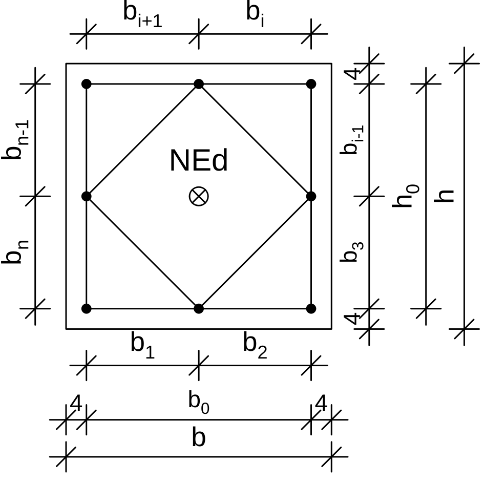

# Utezanje stuba

[← Sadržaj](README.md) · Kod: [`column_bracing.py`](../GUI/ConcreteElementsWindows/column_bracing.py) · Izveštaj: [`ColumnBracing_tex.py`](../LatexScripts/ColumnBracing_tex.py), [`ColumnBracing.tex`](../LatexTemplates/ColumnBracing.tex)

## 1. Namena

Proračun potrebnog utezanja kritične oblasti u dnu primarnog seizmičkog stuba pravougaonog preseka,
po pravilima za klasu duktilnosti DCM (**EN 1998-1, 5.4.3.2.2**). Za izabrani prečnik i obim uzengija
program traži najveći razmak $s$ (od ponuđenih 20, 15, 12.5, 10 i 7.5 cm) pri kome je obezbeđen
potreban mehanički zapreminski procenat utezanja $\omega_{wd}$.

<p align="center"></p>

## 2. Ulazni podaci

| Oznaka | Polje u GUI | Jedinica | Napomena |
|---|---|---|---|
| $N_{Ed}$ | Normalna sila NEd | kN | uzima se apsolutna vrednost |
| $b$, $h$ | Širina b, Visina h | cm | $b_c = b$ |
| $f_{ck}$ | Marka betona fck | MPa | |
| $q_0$ | Faktor ponašanja q0 | – | osnovna vrednost, EN 1998-1 Tabela 5.1 |
| $O$ | Obim uzengija | cm | ukupna dužina svih krakova uzengija i poprečnih spona u jednom redu |
| – | Tip armature | – | B500B ili B500C |
| $\phi_w$ | Prečnik uzengija | mm | 8, 10 ili 12 |
| $T_1$ | Period T | s | osnovni period zgrade |
| $b_i$ | Tabela razmaka | cm | rastojanja između susednih pridržanih šipki |

## 3. Teorijska osnova i formule

### 3.1 Materijal i geometrija jezgra

```math
f_{cd} = 0.85 \cdot \frac{f_{ck}}{1.5}, \qquad
f_{yd} = \frac{500}{1.15}, \qquad
\varepsilon_{sy,d} = 2.174 ‰
```

(EN 1992-1-1, 3.1.6(1)P i 2.4.2.4; vidi [zajedničke osnove](README.md#materijali--srps-en-1992-1-1).)

Dimenzije utegnutog jezgra mere se do osovine uzengija (EN 1998-1, 5.4.3.2.2(8), Slika 5.7).
Program pretpostavlja rastojanje osovine uzengije od ivice preseka od 4 cm:

```math
b_0 = b - 8 \ \mathrm{cm}, \qquad h_0 = h - 8 \ \mathrm{cm}, \qquad A_{sw} = \frac{\phi_w^2 \pi}{4}
```

### 3.2 Normalizovana aksijalna sila

```math
\nu_d = \frac{N_{Ed}}{A_c \cdot f_{cd}} = \frac{N_{Ed}}{b \cdot h \cdot f_{cd}}
```

(EN 1998-1, 5.4.3.2.2(8), definicija uz izraz (5.15).)

- **EN 1998-1, 5.4.3.2.1(3)P:** kod primarnih seizmičkih stubova $\nu_d$ ne sme biti veće od 0.65.
- **EN 1998-1, 5.4.3.2.2(12)P:** poprečna armatura kritične oblasti u dnu stuba može se odrediti samo po
  EN 1992-1-1 ako je $\nu_d < 0.2$ i ako faktor ponašanja $q$ korišćen u proračunu nije veći od 2.0.

### 3.3 Faktor duktilnosti krivine $\mu_\phi$

**EN 1998-1, 5.4.3.2.2(6)P** zahteva da se u kritičnoj oblasti u dnu stuba obezbedi $\mu_\phi$ najmanje
jednak vrednosti iz **5.2.3.4(3)**, izrazi (5.4) i (5.5):

```math
\mu_\phi = 2 q_0 - 1 \quad (T_1 \geq T_C), \qquad
\mu_\phi = 1 + 2 (q_0 - 1) \frac{T_C}{T_1} \quad (T_1 < T_C)
```

Za armaturu klase B vrednost se množi sa 1.5 (**5.2.3.4(4)**). Program to sprovodi koeficijentom $k$
(1.5 za B500B, 1.0 za B500C):

```math
\mu_\phi = k \cdot (2 q_0 - 1) \quad (T_1 \geq T_C), \qquad
\mu_\phi = k \cdot \left[1 + 2 (q_0 - 1) \frac{T_C}{T_1}\right] \quad (T_1 < T_C)
```

Za stubove se koristi osnovna vrednost $q_0$; zamena $q_0 \to q_0 \cdot M_{Ed}/M_{Rd}$ važi samo za zidove (5.4.3.4.2(2)).

### 3.4 Uslov utezanja

**EN 1998-1, 5.4.3.2.2(7)P i (8)**: ako je za traženo $\mu_\phi$ potrebna dilatacija betona veća od
$\varepsilon_{cu2} = 3.5$‰, gubitak nosivosti usled odlamanja zaštitnog sloja nadoknađuje se utezanjem jezgra.
Uslov je zadovoljen ako važi **izraz (5.15)**:

```math
\alpha \cdot \omega_{wd} \geq 30 \, \mu_\phi \, \nu_d \, \varepsilon_{sy,d} \, \frac{b_c}{b_0} - 0.035
```

gde je mehanički zapreminski procenat uzengija

```math
\omega_{wd} = \frac{\text{zapremina uzengija}}{\text{zapremina betonskog jezgra}} \cdot \frac{f_{yd}}{f_{cd}}
= \frac{A_{sw} \cdot O}{b_0 \cdot h_0 \cdot s} \cdot \frac{f_{yd}}{f_{cd}}
```

a koeficijent efikasnosti utezanja $\alpha = \alpha_n \cdot \alpha_s$, za pravougaone preseke
(**izrazi (5.16a) i (5.17a)**):

```math
\alpha_n = 1 - \sum_n \frac{b_i^2}{6 \, b_0 \, h_0}, \qquad
\alpha_s = \left(1 - \frac{s}{2 b_0}\right)\left(1 - \frac{s}{2 h_0}\right)
```

$n$ je ukupan broj podužnih šipki pridržanih uzengijama ili sponama, a $b_i$ rastojanje između
susednih pridržanih šipki (Slika 5.7).

**EN 1998-1, 5.4.3.2.2(9):** u kritičnoj oblasti u dnu stuba treba obezbediti najmanje $\omega_{wd} = 0.08$, pa je
potreban procenat utezanja

```math
\omega_{wd,req} = \max\left(0.08;\ \frac{\alpha \cdot \omega_{wd,req}}{\alpha}\right)
```

**EN 1998-1, 5.4.3.2.2(11):** razmak uzengija $s \leq \min(b_0/2;\ 175 \ \mathrm{mm};\ 8 d_{bL})$ (izraz (5.18)),
a rastojanje pridržanih šipki najviše 200 mm.

## 4. Tok proračuna u programu

Klasa `UtezanjeStuba`:

| Korak | Metoda / atribut | Šta radi |
|---|---|---|
| 1 | `__init__` | Pretvara jedinice (cm → m, MPa → kPa), računa $f_{cd}$, $f_{yd}$, $b_0$, $h_0$, $\nu_d$ (`nied`), površinu jednog kraka uzengije (`izabrani_fi`). |
| 2 | `Armatura()` | Koeficijent za tip armature: 1.5 za B500B, 1.0 za B500C. |
| 3 | `Mfi()` | Računa $\mu_\phi$ po izrazu (5.4) ili (5.5) sa $q_0$, pomnoženo sa $k$. |
| 4 | `Utezanje()` — kontrola sile | $\nu_d > 0.65$ → greška. $\nu_d < 0.2$ i $q_0 \leq 2$ → „primenjuju se pravila iz EC2“, kraj proračuna. |
| 5 | `Utezanje()` — $\alpha_n$ | $\alpha_n = 1 - \sum b_i^2 / (6 b_0 h_0)$ iz tabele razmaka. |
| 6 | `Utezanje()` — petlja po $s$ | Za $s$ = 20, 15, 12.5, 10, 7.5 cm računa $\alpha_s$, $\alpha$, $V_{co} = b_0 h_0 s$, $\omega_{wd,prov}$, $\alpha\omega_{wd,req}$ i $\omega_{wd,req} = \alpha\omega_{wd,req}/\alpha$. $\omega_{wd,req} = \max(0.08;\ \alpha\omega_{wd,req}/\alpha)$. Staje kod prvog $s$ za koji je $\omega_{wd,prov} \geq \omega_{wd,req}$. |
| 7 | `self.detalji`, `self.iteracije` | Međurezultati svih koraka (koristi ih generator izveštaja). |

## 5. Rezultati i kontrole

| Kontrola | Uslov | Ishod |
|---|---|---|
| Maksimalna normalizovana sila | $\nu_d \leq 0.65$ | ako nije ispunjeno: greška, proračun se prekida |
| Primena pravila EC2 | $\nu_d < 0.2$ i $q_0 \leq 2$ | ako je ispunjeno: utezanje se ne proračunava |
| Utezanje za razmak $s$ | $\omega_{wd,prov} \geq \max(0.08;\ \alpha\omega_{wd,req}/\alpha)$ | usvaja se prvi (najveći) $s$ koji zadovoljava; ako nijedan ne zadovoljava: „Nedovoljno utezanje stuba za izabrani prečnik“ |

Prikazuju se $\omega_{wd,prov}$, $\omega_{wd,req}$, $\alpha_s$, $\alpha_n$, $\alpha$ i $\alpha\omega_{wd,req}$ za usvojeni
(ili poslednji provereni) razmak.

## 6. Pretpostavke i odstupanja od Evrokoda

Pretpostavke:

- Zaštitni sloj do osovine uzengija je 4 cm ($b_0 = b - 8$ cm, $h_0 = h - 8$ cm).
- $T_C = 0.5$ s je fiksno. To odgovara preporučenom spektru tipa 1 za tlo tipa B ili E (EN 1998-1, 3.2.2.2, Tabela 3.2);
  za druga tla i spektre (ili vrednosti iz nacionalnog aneksa) treba ga promeniti u kodu.
- Spratna visina $H_s$ se unosi, ali se u proračunu stuba ne koristi.

Odstupanja koja treba imati u vidu:

1. **Uslov za pravila EC2:** 5.4.3.2.2(12)P se odnosi na faktor ponašanja $q$ korišćen u proračunu, a program proverava
   osnovnu vrednost $q_0$ (jedinu koja se unosi).
2. Ograničenja razmaka iz 5.4.3.2.2(11) (izraz (5.18)) se ne proveravaju.
