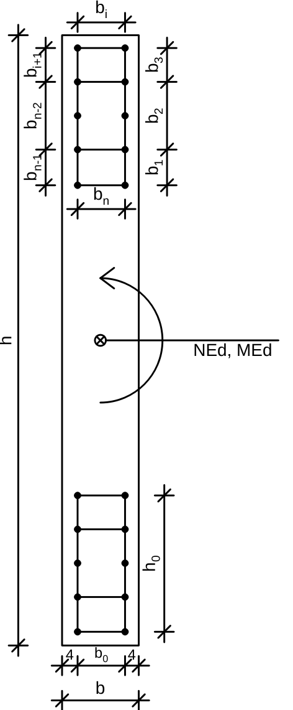

# Utezanje zida

[← Sadržaj](README.md) · Kod: [`wall_bracing.py`](../GUI/ConcreteElementsWindows/wall_bracing.py) · Izveštaj: [`WallBracing_tex.py`](../LatexScripts/WallBracing_tex.py), [`WallBracing.tex`](../LatexTemplates/WallBracing.tex)

## 1. Namena

Provera utezanja ivičnih elemenata (krajeva) duktilnog zida pravougaonog preseka u kritičnoj oblasti,
po pravilima za klasu duktilnosti DCM (**EN 1998-1, 5.4.3.4.2**). Za zadatu dužinu utegnutog elementa $h_0$,
razmak $s$ i prečnik uzengija program proverava obezbeđeni procenat utezanja i potrebnu dužinu utezanja $l_c$.

<p align="center"></p>

## 2. Ulazni podaci

| Oznaka | Polje u GUI | Jedinica | Napomena |
|---|---|---|---|
| – | Naziv platna/zida | – | koristi se u porukama i izveštaju |
| $N_{Ed}$ | Normalna sila NEd | kN | uzima se apsolutna vrednost |
| $b$ ($b_w$) | Debljina zida b | cm | |
| $h$ ($l_w$) | Dužina preseka zida h | cm | |
| $f_{ck}$ | Marka betona fck | MPa | |
| $q_0$ | Faktor ponašanja q0 | – | |
| $h_0$ | Dužina utegnutog elementa h0 | cm | obezbeđena dužina ivičnog elementa, ujedno i dužina jezgra u $\alpha_n$, $\alpha_s$ |
| $O$ | Obim uzengija za pridržavanje | cm | ukupna dužina krakova u jednom redu |
| $s$ | Vertikalni razmak uzengija | cm | |
| – | Tip armature | – | B500B ili B500C |
| $\phi_w$ | Prečnik uzengije | mm | 8, 10, 12 ili 14 |
| $T_1$ | Period T | s | |
| $M_{Ed}$, $M_{Rd}$ | Seizmički moment, Moment nosivosti | kNm | u dnu zida |
| $H_s$ | Čista spratna visina | m | |
| $b_i$ | Tabela razmaka | cm | rastojanja pridržanih šipki u ivičnom elementu |

## 3. Teorijska osnova i formule

### 3.1 Materijal i geometrija

```math
f_{cd} = 0.85 \cdot \frac{f_{ck}}{1.5}, \qquad f_{yd} = \frac{500}{1.15}, \qquad \varepsilon_{sy,d} = 2.174 ‰,
\qquad b_0 = b - 5 \ \mathrm{cm}
```

Mehanički procenat vertikalne armature rebra $\omega_v = \rho_v \, f_{yd,v} / f_{cd}$ (EN 1998-1, 5.4.3.4.2(4)).
Program uzima minimalni procenat armiranja $\rho_v = 0.00201$, po EN 1992-1-1, 9.6.2(1)
(preporučeno $A_{s,vmin} = 0.002 A_c$):

```math
\omega_v = 0.00201 \cdot \frac{f_{yd}}{f_{cd}}
```

### 3.2 Normalizovana aksijalna sila

```math
\nu_d = \frac{N_{Ed}}{b \cdot h \cdot f_{cd}}
```

- **EN 1998-1, 5.4.3.4.1(2):** kod primarnih seizmičkih zidova $\nu_d$ ne treba da bude veće od 0.4.
- **EN 1998-1, 5.4.3.4.2(12):** poprečna armatura ivičnih elemenata može se odrediti samo po EN 1992-1-1 ako je
  a) $\nu_d \leq 0.15$, ili b) $\nu_d \leq 0.20$, a faktor ponašanja u analizi je smanjen za 15%.

### 3.3 Faktor duktilnosti krivine

**EN 1998-1, 5.4.3.4.2(2):** $\mu_\phi$ se računa po izrazima (5.4) i (5.5) iz 5.2.3.4(3), s tim da se $q_0$ zamenjuje
proizvodom $q_0$ i najveće vrednosti odnosa $M_{Ed}/M_{Rd}$ u dnu zida:

```math
q_0' = q_0 \cdot \frac{M_{Ed}}{M_{Rd}}, \qquad
\mu_\phi = 2 q_0' - 1 \quad (T_1 \geq T_C), \qquad
\mu_\phi = 1 + 2 (q_0' - 1) \frac{T_C}{T_1} \quad (T_1 < T_C)
```

Za armaturu klase B vrednost se množi sa 1.5 (**5.2.3.4(4)**). Program to sprovodi koeficijentom $k$
(1.5 za B500B, 1.0 za B500C). Ako je $q_0 \cdot M_{Ed}/M_{Rd} < 1$, usvaja se $q_0' = 1$ (tada je $\mu_\phi = k$):

```math
q_0' = \max\left(1;\ q_0 \frac{M_{Ed}}{M_{Rd}}\right), \qquad
\mu_\phi = k \cdot (2 q_0' - 1) \quad (T_1 \geq T_C), \qquad
\mu_\phi = k \cdot \left[1 + 2 (q_0' - 1) \frac{T_C}{T_1}\right] \quad (T_1 < T_C)
```

### 3.4 Potreban procenat utezanja

**EN 1998-1, 5.4.3.4.2(4), izraz (5.20):**

```math
\alpha \cdot \omega_{wd} \geq 30 \, \mu_\phi \, (\nu_d + \omega_v) \, \varepsilon_{sy,d} \, \frac{b_c}{b_0} - 0.035
```

Ostale veličine su definisane kao kod stubova (**5.4.3.2.2(8)**, izrazi (5.16a) i (5.17a)):

```math
\alpha = \alpha_n \cdot \alpha_s, \qquad
\alpha_n = 1 - \sum_n \frac{b_i^2}{6 \, b_0 \, h_0}, \qquad
\alpha_s = \left(1 - \frac{s}{2 b_0}\right)\left(1 - \frac{s}{2 h_0}\right), \qquad
\omega_{wd} = \frac{A_{sw} \cdot O}{b_0 \cdot h_0 \cdot s} \cdot \frac{f_{yd}}{f_{cd}}
```

**EN 1998-1, 5.4.3.4.2(9)** propisuje da se odredbe **5.4.3.2.2(9)** primenjuju i na ivične elemente zidova,
pa je najmanji procenat utezanja $\omega_{wd} = 0.08$:

```math
\omega_{wd,req} = \max\left(0.08;\ \frac{\alpha \cdot \omega_{wd,req}}{\alpha}\right)
```

### 3.5 Dužina utegnutog ivičnog elementa

Visina pritisnute zone pri graničnoj krivini, posle odlamanja zaštitnog sloja (**EN 1998-1, 5.4.3.4.2(5), izraz (5.21)**):

```math
x_u = (\nu_d + \omega_v) \cdot \frac{l_w \cdot b_c}{b_0}
```

Granična dilatacija utegnutog betona (**EN 1998-1, 5.4.3.4.2(6)**, na osnovu EN 1992-1-1, 3.1.9):

```math
\varepsilon_{cu2,c} = 0.0035 + 0.1 \, \alpha \, \omega_{wd}
```

Utegnuti ivični element se prostire do tačke u kojoj dilatacija dostiže $\varepsilon_{cu2} = 3.5$‰ (**5.4.3.4.2(6)**):

```math
l_c = x_u \left(1 - \frac{\varepsilon_{cu2}}{\varepsilon_{cu2,c}}\right), \qquad l_c \geq \max(0.15 \, l_w;\ 1.5 \, b_w)
```

### 3.6 Debljina utegnutog elementa i podužna armatura

**EN 1998-1, 5.4.3.4.2(10):** debljina $b_w$ utegnutih delova ne sme biti manja od 200 mm. Ako dužina utegnutog dela
nije veća od $\max(2 b_w;\ 0.2 l_w)$, treba da je $b_w \geq h_s/15$; ako je veća, $b_w \geq h_s/10$ ($h_s$ je spratna visina).
Program za dužinu utegnutog dela uzima $h_0$:

```math
b_{w,min} = \max\left(200 \ \mathrm{mm};\ \frac{H_s}{10}\right) \ \text{za } h_0 > \max(2 b_w;\ 0.2 l_w), \qquad
b_{w,min} = \max\left(200 \ \mathrm{mm};\ \frac{H_s}{15}\right) \ \text{inače}
```

**EN 1998-1, 5.4.3.4.2(8):** procenat podužne armature u ivičnim elementima ne treba da bude manji od 0.005.

## 4. Tok proračuna u programu

Klasa `UtezanjeZida`:

| Korak | Metoda | Šta radi |
|---|---|---|
| 1 | `__init__` | Jedinice, $f_{cd}$, $f_{yd}$, $b_0 = b - 5$ cm, $\omega_v$, $\nu_d$ (`ni`), površina kraka uzengije (`a1_uz`). |
| 2 | `Armatura()`, `q0_prim()`, `Mfi()` | Koeficijent za tip armature (1.5 / 1.0), $q_0' = \max(1;\ q_0 M_{Ed}/M_{Rd})$ i $\mu_\phi$ po (5.4) ili (5.5). |
| 3 | `Alfa_n()`, `Alfa_s()`, `Alfa()` | $\alpha_n$, $\alpha_s$, $\alpha = \alpha_n \alpha_s$ (sa $b_0$ i $h_0$). |
| 4 | `alfa_omega_dreq()` | $\alpha\omega_{wd,req}$ po izrazu (5.20). |
| 5 | `Minimalna_Duzina_Utezanja()` | $x_u$, $\varepsilon_{cu2,c}$ iz potrebnog $\alpha\omega_{wd,req}$, $l_c$ i minimum $\max(0.15 h;\ 1.5 b)$. |
| 6 | `Minimalna_debljina()`, `Kontrola_minimalne_debljine_utegnutog_elementa()` | $b_{w,min}$ po 5.4.3.4.2(10) i kontrola $b \geq b_{w,min}$. |
| 7 | `Utezanje()` | Kontrole $\nu_d$; obezbeđeno $\omega_{wd,prov}$; kontrola $\omega_{wd,prov} \geq \max(0.08;\ \alpha\omega_{wd,req}/\alpha)$; $\varepsilon_{cu2,c}$ i $l_c$ iz obezbeđenog $\alpha\,\omega_{wd,prov}$; kontrola $l_c < h_0$. Međurezultati se čuvaju u `self.detalji`. |

## 5. Rezultati i kontrole

| Kontrola | Uslov | Ishod |
|---|---|---|
| Potreba za utezanjem | $\nu_d > 0.15$ | ako nije ispunjeno: „Nije potrebno utezanje krajeva zida“ |
| Maksimalna normalizovana sila | $\nu_d \leq 0.4$ | ako nije ispunjeno: greška, proračun se prekida |
| Procenat utezanja | $\omega_{wd,prov} \geq \max(0.08;\ \alpha\omega_{wd,req}/\alpha)$ | ako nije ispunjeno: „Nije obezbeđeno dovoljno utezanje ivičnog elementa“ |
| Debljina utegnutog elementa | $b \geq b_{w,min}$ | ako nije ispunjeno: „Debljina zida je manja od bw,min“ |
| Dužina utezanja | $l_c < h_0$ | ispunjeno: „Dovoljno utegnut kraj zida“; inače: smanjiti stepen utezanja ili produžiti ivični element |

Prikazuju se i: $\nu_d$, $l_c$, $h_0$, minimalna dužina $l_{c,min}$, $\alpha_s$, $\alpha_n$, $\alpha$, $\omega_{wd,prov}$,
$\alpha\omega_{wd,req}$, $\omega_{wd,req}$ i $b_{w,min}$.

## 6. Pretpostavke i odstupanja od Evrokoda

Pretpostavke:

- $b_0 = b - 5$ cm (osovina uzengije 2.5 cm od ivice).
- $\omega_v$ odgovara minimalnoj vertikalnoj armaturi ($\rho_v = 0.00201$), a ne stvarnoj armaturi rebra.
- $T_C = 0.5$ s je fiksno (preporučeni spektar tipa 1, tlo B ili E, EN 1998-1 Tabela 3.2).
- $l_w = h$, $b_c = b_w = b$ (pravougaoni presek bez flanši; za preseke sa flanšama važi 5.4.3.4.2(5) i (7), što program ne obuhvata).

Odstupanja koja treba imati u vidu:

1. **Minimalna dužina** $l_{c,min} = \max(0.15 l_w;\ 1.5 b_w)$ se prikazuje, ali se ne poredi sa $h_0$; kontrola dužine koristi samo $l_c$
   iz obezbeđenog utezanja.
2. **Alternativa b) iz 5.4.3.4.2(12)** ($\nu_d \leq 0.20$ uz smanjen faktor ponašanja) nije obuhvaćena.
3. Procenat podužne armature ivičnih elemenata (5.4.3.4.2(8)) se ne proverava.
